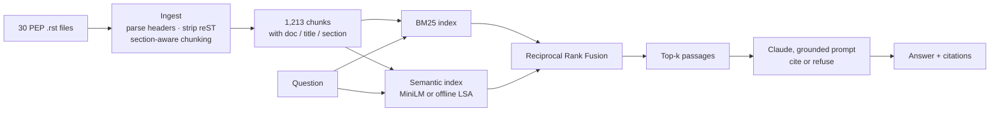
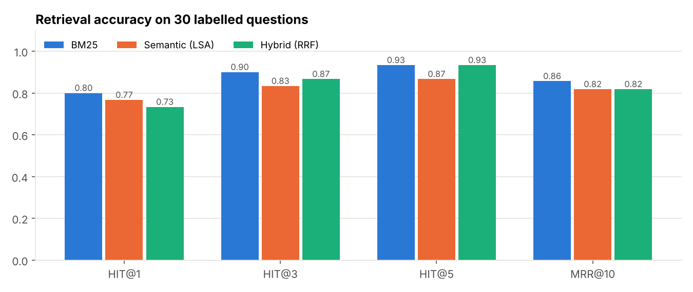

# RAG Document Q&A Assistant

A retrieval-augmented generation (RAG) assistant that answers questions about **30 Python Enhancement Proposals (PEPs)** with answers grounded in the source text and numbered citations, plus an evaluation harness that measures retrieval quality instead of guessing at it.

Ask *"How do I make zip raise an error when iterables have different lengths?"* and it retrieves the relevant passages from PEP 618, then answers with Claude, citing `[1]`, `[2]`... so every claim can be checked.



## Features

- **Section-aware chunking.** Documents are split on reST headings first, then long sections are windowed (180 words, 40-word overlap), so chunks don't straddle unrelated sections. Boilerplate sections (Copyright, References) are dropped. Each chunk keeps its PEP number, title and section for citations.
- **Three retrievers, measured side by side.** BM25 for exact terms (`ParamSpec`, `WSGI`), semantic search for paraphrased questions, and a hybrid that fuses both with Reciprocal Rank Fusion. Semantic search uses `sentence-transformers` (all-MiniLM-L6-v2) when installed and falls back to an offline LSA model (TF-IDF + SVD), so the project runs with no downloads.
- **Grounded generation.** Claude answers only from the retrieved passages at temperature 0, must cite passage numbers, and must say *"I couldn't find that in the indexed documents"* rather than use outside knowledge. Without an API key, an extractive generator returns the most relevant cited sentences instead.
- **Evaluation harness.** 30 labelled questions written the way users actually ask (*"Is there a shorter way to write Union[int, str]?"*), scored with Hit@k and MRR.
- **Streamlit chat UI and CLI**, plus 8 unit tests including a mocked LLM test that checks the exact prompt sent to the model.

## Retrieval evaluation

```
     retriever  hit@1  hit@3  hit@5  mrr@10  avg_latency_ms
          BM25  0.800  0.900  0.933   0.857           1.6
Semantic (LSA)  0.767  0.833  0.867   0.818           7.9
  Hybrid (RRF)  0.733  0.867  0.933   0.818           8.1
```



**What the numbers say:** BM25 alone finds the right PEP in the top 3 for **90%** of questions and is the best retriever *with the offline LSA embeddings*. LSA's errors drag the hybrid's top-1 accuracy down, so the pipeline picks BM25 as its default when only LSA is available and switches to hybrid when neural embeddings load. The misses are informative: they cluster on the typing PEPs (484, 526, 544, 673), which share vocabulary heavily, so a question about "annotating a class attribute" lands on the wrong typing PEP. A cross-encoder re-ranker or neural embeddings are the natural next steps, and the harness makes it easy to verify whether they actually help.

## Run it

```bash
pip install -r requirements.txt

# optional: generated answers from Claude (otherwise extractive answers are returned)
export ANTHROPIC_API_KEY=sk-ant-...
# optional: neural embeddings for semantic/hybrid search
pip install sentence-transformers

python ask.py "Why was the walrus operator added to Python?"
python ask.py --retriever hybrid "How do I annotate a method that returns its own class?"
streamlit run app.py          # chat UI with retriever settings and expandable sources
python eval/run_eval.py       # retrieval metrics + chart
pytest                        # 8 tests
```

The model defaults to `claude-haiku-5-5` and can be changed with `RAG_MODEL`. To use your own documents, drop `.rst` files in `data/peps/` (or adapt `load_documents` in `rag/ingest.py` for PDFs or Markdown).

## Project structure

```
├── rag/
│   ├── ingest.py      # header parsing, reST cleaning, section-aware chunking
│   ├── retrievers.py  # BM25, semantic (MiniLM / LSA), hybrid RRF
│   ├── generator.py   # grounded Claude prompt + extractive fallback
│   └── pipeline.py    # ingest -> index -> retrieve -> generate
├── eval/
│   ├── questions.jsonl  # 30 labelled questions
│   └── run_eval.py      # Hit@k, MRR, latency
├── app.py             # Streamlit UI
├── ask.py             # CLI
├── data/peps/         # corpus: 30 PEPs (public domain)
└── tests/
```

## Tools

Python · Anthropic Claude API · rank-bm25 · scikit-learn · sentence-transformers (optional) · Streamlit · pytest

The corpus is a selection of PEPs from [python/peps](https://github.com/python/peps), which are placed in the public domain.
